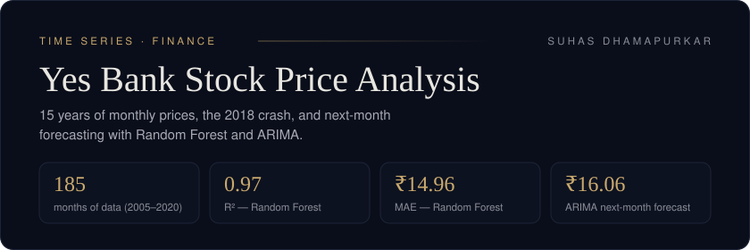

> **In one line:** an analysis of 15 years of Yes Bank monthly stock prices, including the collapse after the 2018 fraud case, with a Random Forest model and an ARIMA forecast for the next month's close.

## Problem

Yes Bank's stock went from steady growth to a sharp collapse after the 2018 fraud case involving its founder. This project asks:

1. How did the price behave before and after 2018?
2. How well can models estimate and forecast the monthly closing price?

## Data

Monthly **Open, High, Low and Close** prices for **185 months (Jul 2005 – Nov 2020)**, with no missing values. The CSV (`data_YesBank_StockPrices.csv`) is not included in this repo; place it next to the notebook to run it.

## Approach

| Step | What was done |
| --- | --- |
| Preparation | Parsed `Mon-YY` dates into a monthly time index; added Month and Year features |
| EDA | Price trend with the 2018 event marked, distributions and a correlation matrix |
| Random Forest | Estimated the monthly **Close** from that month's Open, High, Low, Month and Year (chronological 80/20 split, no shuffling) |
| ARIMA (5,1,0) | Fitted on the closing-price series to forecast the **next month's close** |

## Results

| Model | Metric | Value |
| --- | --- | --- |
| Random Forest | MAE | **₹14.96** |
| Random Forest | RMSE | ₹23.57 |
| Random Forest | R² | **0.97** |
| ARIMA (5,1,0) | Next-month close forecast | **₹16.06** |

## Insights

- The stock grew steadily to a peak near **₹367.90** before 2018, then fell sharply as investor confidence collapsed.
- Open, High, Low and Close are almost perfectly correlated (≈0.99), so within a month the price moves as one.
- The Random Forest predictions follow the actual prices closely, with the biggest errors in the most volatile months.

## Limitations and next steps

- The Random Forest uses the same month's Open, High and Low, so it estimates the close rather than forecasting it ahead of time. The ARIMA model is the true forward forecast.
- Next steps: add a seasonal SARIMA model, use lagged features for the Random Forest, and backtest the forecasts month by month.

## Files

| File | Contents |
| --- | --- |
| `Yes_Bank_Stock_Price_Analysis.ipynb` | Main notebook: EDA, Random Forest, ARIMA |
| `Yes_Bank_Analysis.ipynb` | Earlier version of the same analysis |

---

Built by <a href="https://github.com/Suhas5497"><b>Suhas Dhamapurkar</b></a> — Data Analyst &amp; AI/ML Engineer · Founder of <a href="https://resilytics.in">Resilytics</a> 
<a href="https://linkedin.com/in/suhas-1710d">LinkedIn</a> · <a href="https://portfolio-git-main-suhasdhamapurkar1710-gmailcoms-projects.vercel.app/">Portfolio</a> · <a href="mailto:suhasdhamapurkar1710@gmail.com">Email</a>

